<picture>
<source media="(prefers-color-scheme: dark) and (max-width: 600px)" srcset="assets/terminal/classic-mobile-dark.png">
<source media="(prefers-color-scheme: light) and (max-width: 600px)" srcset="assets/terminal/classic-mobile-light.png">
<source media="(prefers-color-scheme: dark)" srcset="assets/terminal/classic-desktop-dark.png">
<source media="(prefers-color-scheme: light)" srcset="assets/terminal/classic-desktop-light.png">
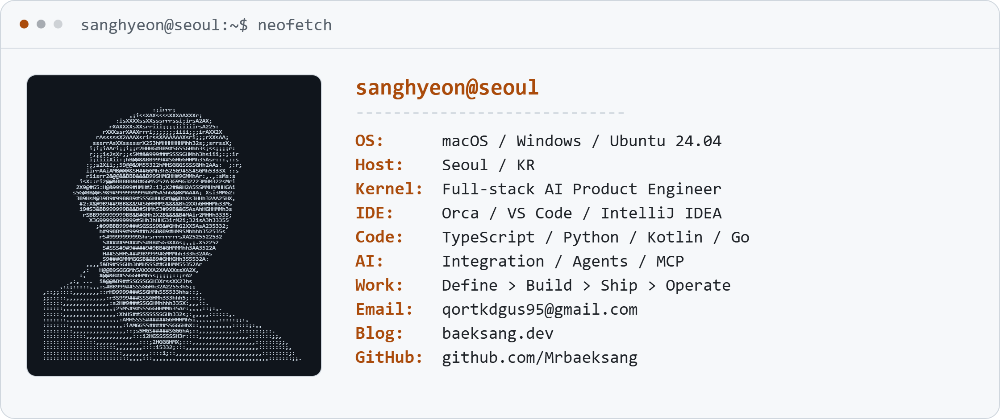
</picture>

# 백상현 · Sanghyeon Baek

### 기업의 업무를 시스템으로 만들고, AI 제품을 개발·운영합니다.

웹·앱·백엔드부터 AI 연동과 배포까지 개발합니다. 기업 의뢰 프로젝트는 단독 수행했으며, 직접 출시한 제품도 운영하고 있습니다.

[포트폴리오](https://baeksang.dev/work) · [공개 코드](https://github.com/Mrbaeksang?tab=repositories) · [개발 기록](https://baeksang.dev/notes) · [이메일](mailto:qortkdgus95@gmail.com)

## 기업과 함께 만든 시스템

의뢰받은 범위의 설계·개발을 단독 수행했습니다. 각 프로젝트의 담당 범위와 구현 내용은 상세 페이지에서 확인할 수 있습니다.

<table>
<tr>
<td width="50%" valign="top">
<a href="https://baeksang.dev/work/askup">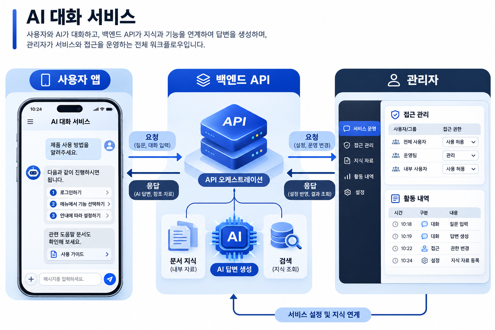</a>
<h3>AskUp · Upstage</h3>

크로스플랫폼 앱·백엔드·관리자 기능 개발. AI 대화 스트리밍, 문서 처리, 인증과 대화 기억을 연결했습니다.

Kotlin Multiplatform · Spring Boot · PostgreSQL

<a href="https://baeksang.dev/work/askup">담당 범위 보기 →</a>
</td>
<td width="50%" valign="top">
<a href="https://baeksang.dev/work/asahi">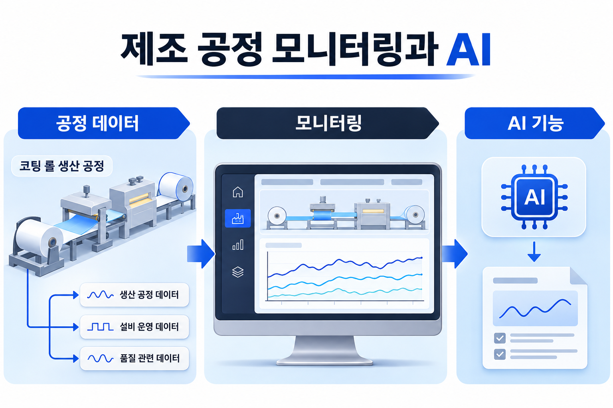</a>
<h3>아사히카세이</h3>

한국법인의 도공공정 모니터링 갱신과 AI 기능 개발을 수행했습니다. 전체 과업을 완료하고 소스코드를 이관했습니다.

제조 공정 모니터링 · AI 기능 개발

<a href="https://baeksang.dev/work/asahi">담당 범위 보기 →</a>
</td>
</tr>
<tr>
<td width="50%" valign="top">
<a href="https://baeksang.dev/work/yamujin">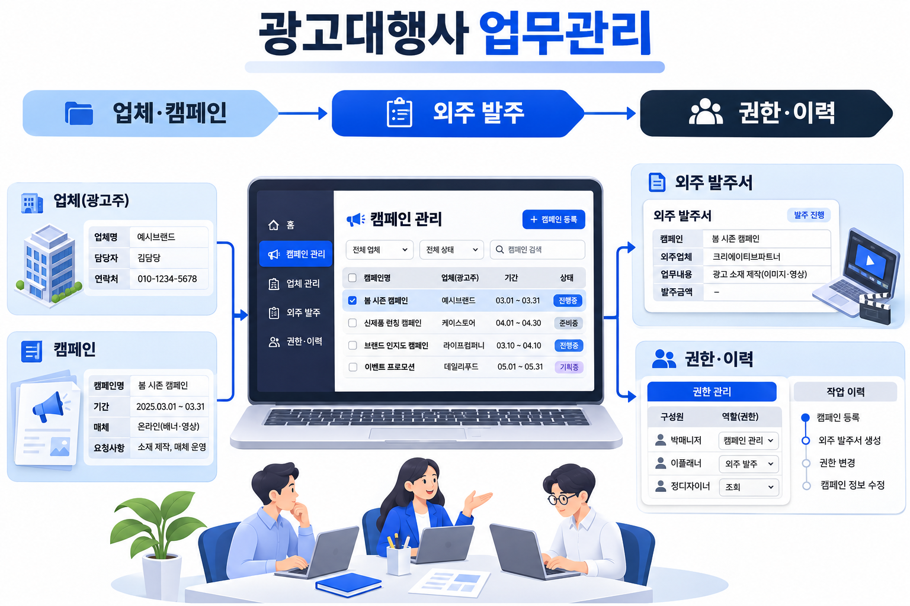</a>
<h3>야무진마케팅</h3>

업체·캠페인·외주 발주를 연결한 맞춤 업무관리 시스템. 발주서 생성과 역할별 권한, 변경 이력을 구현했습니다.

FastAPI · React · PostgreSQL

<a href="https://baeksang.dev/work/yamujin">담당 범위 보기 →</a>
</td>
<td width="50%" valign="top">
<a href="https://baeksang.dev/work/qnova">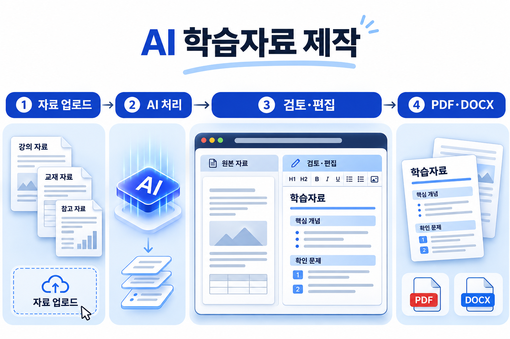</a>
<h3>Qnova</h3>

교재 업로드부터 AI 학습자료 생성, 검토·편집, PDF·DOCX 출력까지 웹과 백엔드 전체를 개발했습니다.

Next.js · FastAPI · LangGraph

<a href="https://baeksang.dev/work/qnova">담당 범위 보기 →</a>
</td>
</tr>
</table>

이미지는 업무 흐름을 설명하는 AI 인포그래픽입니다. 화면과 데이터는 예시이며 실제 서비스 화면이 아닙니다.

**Timely AI MCP Hub** — 웹·백엔드 설계·개발 및 소스 전달. 도구의 병렬 실행, 진행 상태 스트리밍, 예약 작업과 결과 알림을 연결했습니다. [프로젝트 보기](https://baeksang.dev/work/timely)

## 직접 만들고 운영하는 제품

### [사주박사](https://baeksang.dev/work/sajubaksa)

<a href="https://baeksang.dev/assets/projects/sajubaksa/phone-01-master-wolryeong.webp">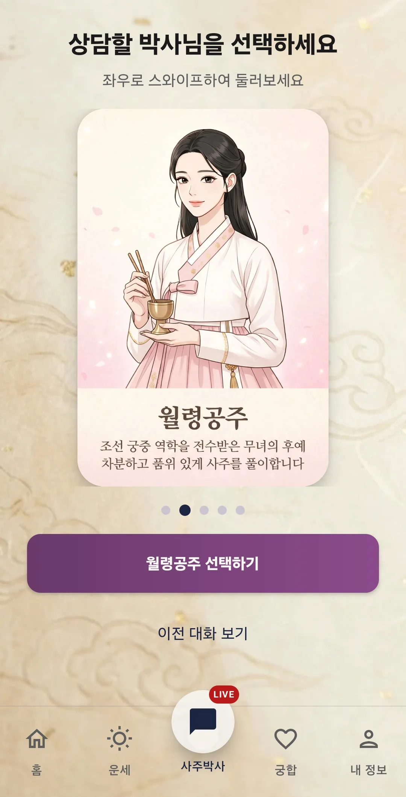</a>
<a href="https://baeksang.dev/assets/projects/sajubaksa/phone-04-fortune-yearly-lifetime.webp">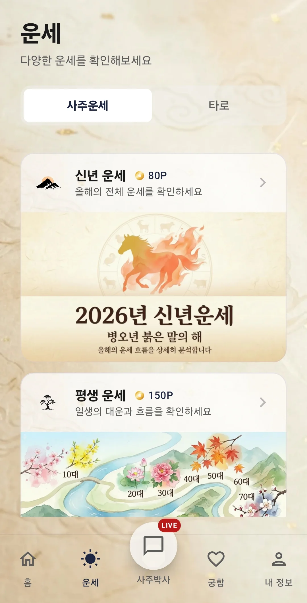</a>
<a href="https://baeksang.dev/assets/projects/sajubaksa/phone-02-tarot-money-job.webp">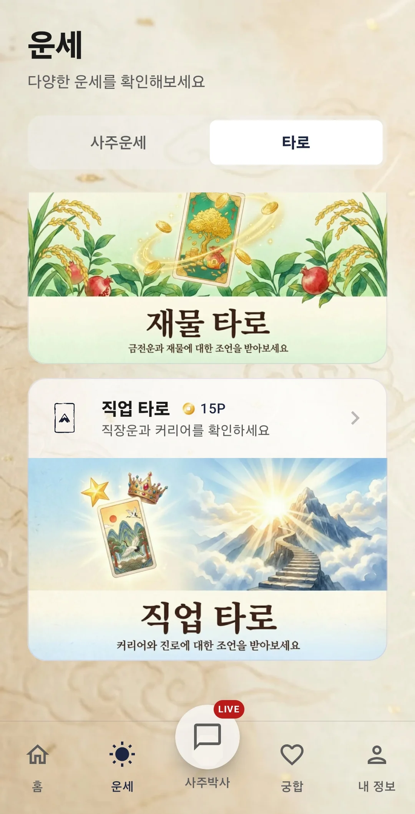</a>

포트폴리오에 공개한 실제 앱 화면 · 캐릭터 선택 / 운세 / 타로

캐릭터와 대화하는 AI 운세 서비스. 웹·모바일·백엔드와 상담 기록, 크레딧·인앱결제를 개발하고 Google Play에 출시했습니다.

[Google Play](https://play.google.com/store/apps/details?id=com.sajubaksa.android) · [개발 기록](https://baeksang.dev/notes/토스-미니앱-google-play-동시-출시-회고-사주박사)

### [baeksang.dev](https://baeksang.dev)

<a href="https://baeksang.dev/daily">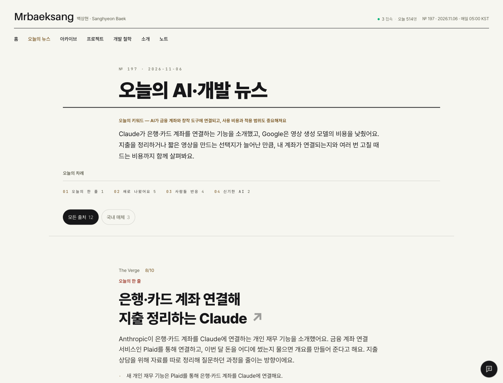</a>

실제 운영 중인 AI 브리핑 페이지 · 2026.11.06 캡처

AI·개발 소식의 수집 → 중복 제거 → 분류·편집 → 발행을 직접 개발·운영합니다. 성공한 작업의 결과를 재사용하고 실패 지점부터 다시 시작하도록 구성했습니다.

[AI 브리핑](https://baeksang.dev/daily) · [개발 기록](https://baeksang.dev/notes/매일-아침-8시-ai가-개발-뉴스를-자동-큐레이션하기까지)

### [HWPX 한글 도우미](https://baeksang.dev/work/hwpx)

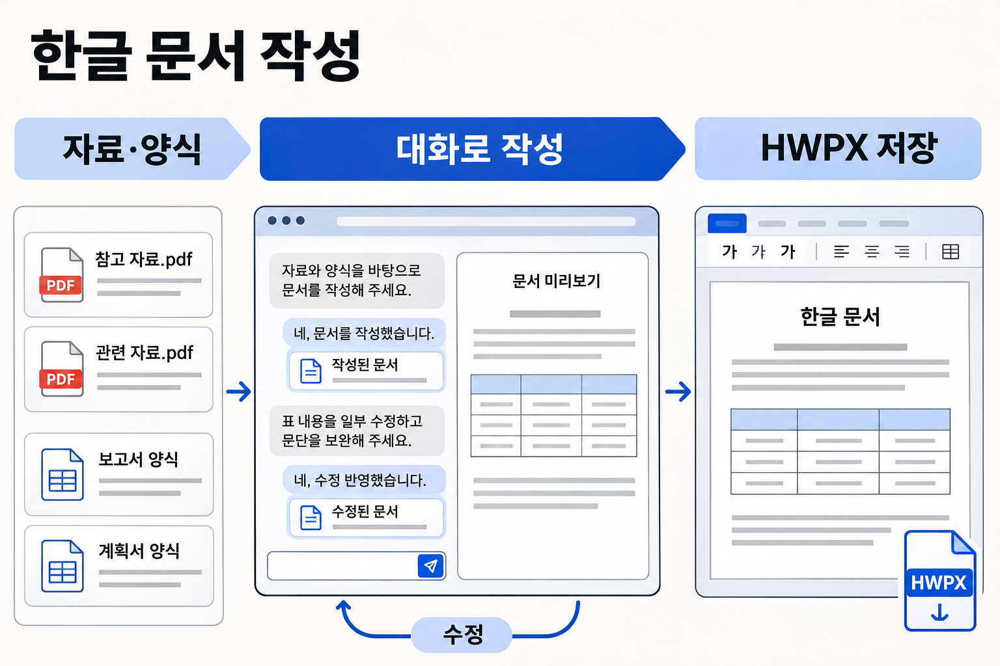

참고자료와 양식을 바탕으로 대화하며 한글 문서를 만드는 서비스입니다. 문서 버전·양식 구조 보존·자료 처리와 다운로드 흐름을 개발하고 유지보수합니다.

업무 흐름을 설명하는 AI 인포그래픽이며 실제 화면이 아닙니다.

[전체 프로젝트 보기 →](https://baeksang.dev/work)

## 공개 코드

### [DeepCloak](https://github.com/Mrbaeksang/deepcloak)

리서치 엔진에 선택적 브라우저 재시도와 근거 기록을 연결한 **Python CLI · MCP 도구**입니다. 로컬 또는 외부 LLM을 선택할 수 있습니다.

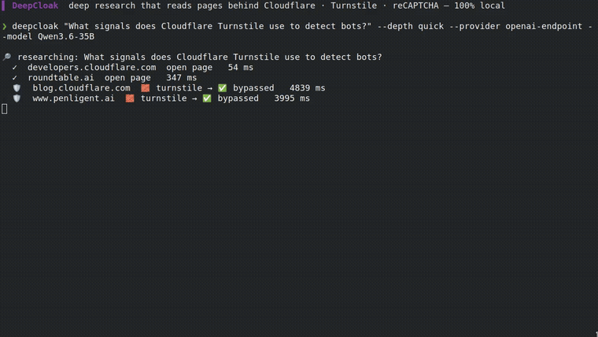

공개 저장소의 실제 실행 데모입니다.

- [Korea Stock Analyzer MCP](https://github.com/Mrbaeksang/korea-stock-analyzer-mcp) — DART 공시·KRX 시세 조회·분석
- [My Site Template](https://github.com/Mrbaeksang/my-site-template) — 화면에서 내용을 편집하는 Next.js 포트폴리오 템플릿

## 현재 하는 일

**마드라스체크 · AI사업개발실 책임** · 2026.04–현재

- **Flow AI** — 계획·도구 실행·결과 검증을 연결하는 Agent와 제품 기능 개발
- **OKR SaaS** — 프론트엔드·백엔드·DB·배포를 단독 개발해 출시하고, 유료 고객 피드백을 반영하며 운영
- **사내 업무 자동화** — 교육 운영 관리와 지출결의 기한 알림 등 반복 업무 개선

구현 과정에서 중요하게 다룬 문제

- 스트리밍 응답의 chunk 경계와 앱·서버 간 데이터 계약
- 저장된 도구명·인자를 코드로 실행하는 예약 작업과 실패 이력
- 긴 AI 작업의 진행 상태 저장과 재접속 후 결과 조회
- 결제 Webhook의 중복 전달과 실패 이벤트 재처리
- 외부 AI API 사용이 제한된 환경에서의 로컬 모델 서빙

[개발 철학과 판단 기록](https://baeksang.dev/harness)

## 주로 사용하는 기술

**웹·모바일** · TypeScript · React / Next.js · Kotlin Multiplatform / Compose  
**백엔드** · Spring Boot · NestJS · Hono / Bun · FastAPI · Go  
**데이터·운영** · PostgreSQL / pgvector · Redis · SQLite · Docker · AWS · Railway · Vercel  
**AI·Agent** · Python · MCP · LangGraph · Spring AI · OpenRouter · vLLM

수상·선정·교육

- 2025 AI_TOP_100 본선 진출
- APEX Expert AI 파일럿 44명 중 3위 · 88/100점 (2026.08)
- Upstage Solar Agent Partner Program Stage 1 선정 (2026.07)
- 마드라스체크 AI사업개발실 분기 혁신상
- Anthropic Academy 18개 수료 · SQLD · TOEIC 815

---

**개발할 업무 시스템이나 AI 제품이 있나요?**  
현재 업무 방식과 필요한 기능을 알려주세요. 관련 수행 경험을 바탕으로 개발 범위를 함께 정리합니다.

[이메일 보내기](mailto:qortkdgus95@gmail.com) · [포트폴리오 보기](https://baeksang.dev/work)
